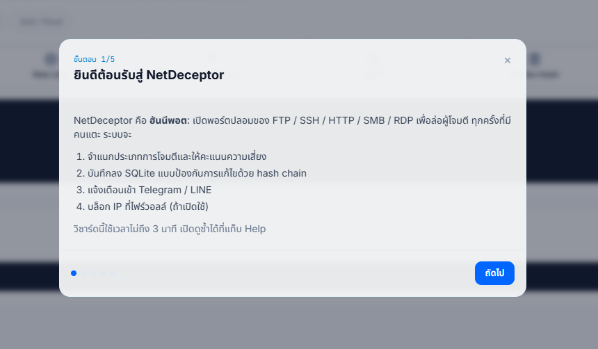
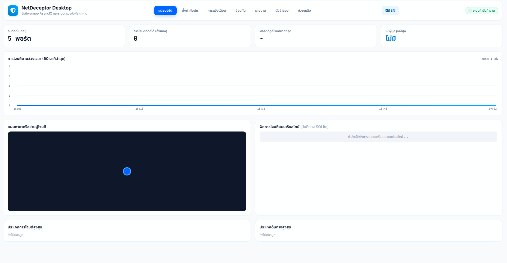
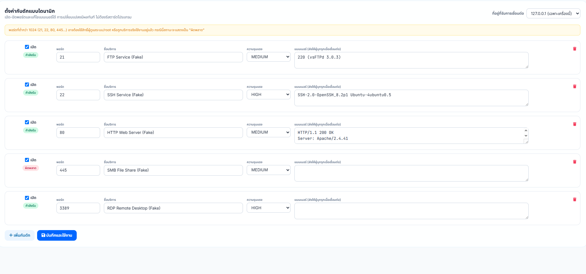
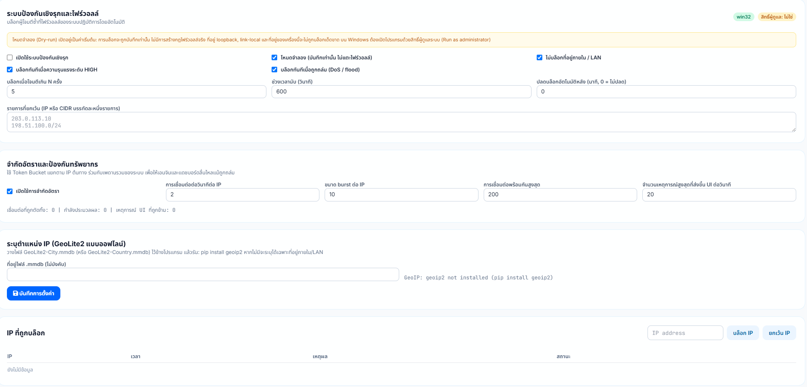
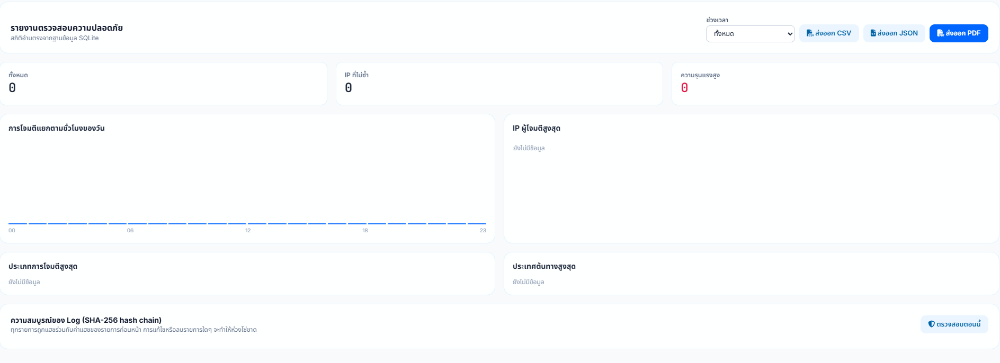
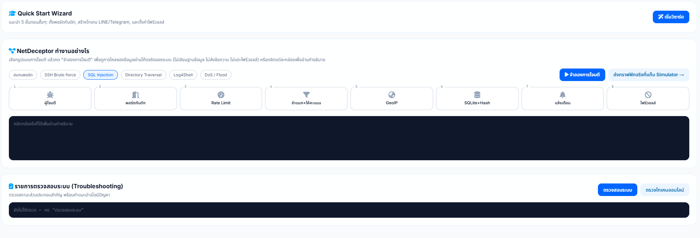
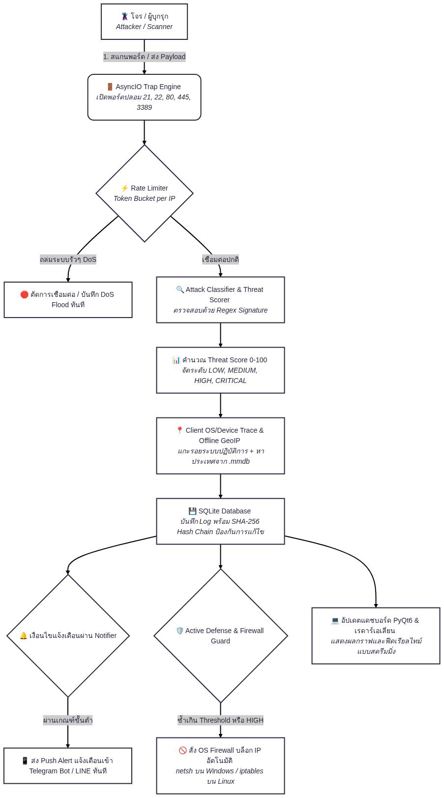

<p align="center">
  
</p>

<h1 align="center">NetDeceptor Desktop</h1>
<p align="center"><b>Enterprise Honeypot & Threat Inspector</b></p>
# NetDeceptor

NetDeceptor can run either as a desktop dashboard or as a foreground headless
honeypot process. The headless mode does not require PyQt6.

## Project layout

- `app.py` is the backward-compatible launcher.
- `netdeceptor/config.py` loads and validates application settings.
- `netdeceptor/database.py` stores events and verifies the hash chain.
- `netdeceptor/services.py` contains classification, notifications, rate limiting,
  geolocation, and firewall-defense helpers.
- `netdeceptor/engine.py` runs the asyncio honeypot and traffic simulator.
- `netdeceptor/reports.py` exports CSV, JSON, and optional PDF reports.
- `netdeceptor/dashboard.py` contains the desktop UI and its Python/JavaScript bridge.
- `netdeceptor/cli.py` selects desktop or headless startup.
- `netdeceptor/compat.py` provides shared paths, standard-library imports, and
  optional PyQt compatibility for headless installs.

## Headless mode

Run from the project directory:

```powershell
python app.py --headless
```

The process listens on the enabled ports in `netdeceptor_config.json`, writes
events to `netdeceptor.db`, and exits cleanly when it receives Ctrl+C or a
termination signal. Paths can be overridden:

```powershell
python app.py --headless --config C:\NetDeceptor\config.json --db C:\NetDeceptor\events.db
```

On Linux, run the same foreground command under a supervisor such as systemd.
On Windows, use an approved service wrapper or supervisor; this script does not
install itself as a Windows Service.

The default bind address is `127.0.0.1`. Only change it to a network interface
address in an isolated, authorized test environment, and restrict inbound and
outbound traffic with host and network firewalls. Ports below 1024 may require
elevated privileges or may already be in use. Firewall blocking remains in
dry-run mode by default.

Use `python app.py --help` to see command-line options. Omitting `--headless`
continues to launch the desktop application.

## 🖥️ หน้าต่างการใช้งานและฟีเจอร์หลัก (Pages & Features)

โปรเจค **NetDeceptor** ถูกออกแบบมาด้วยหน้าจอแดชบอร์ดสไตล์ Dark SOC ที่มีความทันสมัยและใช้งานง่าย โดยแบ่งสัดส่วนการทำงานออกเป็นหน้าหลักต่างๆ ดังนี้:

### 1. Onboarding Wizard (วิซาร์ดแนะนำการใช้งานเบื้องต้น)
<p align="center">
  
</p>

- ปรากฏขึ้นมาอัตโนมัติเมื่อเริ่มใช้งานโปรแกรมครั้งแรก เพื่อแนะนำแนวคิดของฮันนีพอต (Honeypot) ใน 5 ขั้นตอนสั้นๆ
- ช่วยให้ผู้ใช้งานเข้าใจระบบการทำงาน การจำแนกประเภทการโจมตี การบันทึก Log ป้องกันการปลอมแปลง และระบบแจ้งเตือนภัยคุกคามได้อย่างรวดเร็ว

### 2. Dashboard (หน้าแดชบอร์ดหลัก)
- **Overview Metrics:** แสดงตัวชี้วัดสำคัญ เช่น จำนวนพอร์ตกับดักที่เปิดใช้งาน, จำนวนการโจมตีทั้งหมด, พอร์ตเป้าหมายยอดนิยม และ IP ล่าสุดของผู้บุกรุก
- **Timeline Chart:** กราฟแสดงสถิติการโจมตีย้อนหลัง 60 นาทีแบบเรียลไทม์
- **Network Mesh Visualizer:** แผนภาพอนิมชันจำลองเครือข่ายและการเชื่อมต่อของผู้บุกรุก
- **Telemetry Feed:** ฟีดแสดงข้อมูล Log การโจมตีสดๆ ที่ดึงมาจากฐานข้อมูล SQLite

### 3. Trap Config (หน้าตั้งค่าพอร์ตกับดัก)
- อนุญาตให้ผู้ใช้เปิด/ปิดพอร์ตกับดัก (เช่น FTP บนพอร์ต 21, SSH บนพอร์ต 22, HTTP บนพอร์ต 80 และ RDP บนพอร์ต 3389) ได้แบบไดนามิก
- สามารถแก้ไขข้อความ **Banner** ที่จะส่งไปล่อลวงผู้บุกรุกได้ทันทีโดยไม่ต้องรีสตาร์ตโปรแกรม และเลือกตั้งค่า Bind Address ได้ตามต้องการ

### 4. Alerts (หน้าตั้งค่าการแจ้งเตือน)
- ตั้งค่าการส่งข้อความแจ้งเตือนภัยคุกคามแบบเรียลไทม์ไปยังมือถือผ่าน **Telegram Bot** และ **LINE Messaging API**
- กำหนดระดับความรุนแรงขั้นต่ำในการแจ้งเตือน (เช่น เฉพาะ HIGH หรือทุกระดับ) พร้อมระบบหน่วงเวลา (Cooldown) ป้องกันการแจ้งเตือนรัวเกินไป

### 5. Defense (หน้าจัดการระบบป้องกันเชิงรุก)
- **Active Defense:** ควบคุมระบบบล็อก IP อันตรายที่ไฟร์วอลล์ของระบบปฏิบัติการอัตโนมัติ (รองรับ Windows Firewall ผ่าน `netsh` และ Linux ผ่าน `iptables`) พร้อมโหมดทดสอบ (Dry-run)
- **Rate Limiting:** ป้องกันการโจมตีแบบ DoS/Flood ด้วยระบบ Token Bucket ควบคุมอัตราการเชื่อมต่อต่อ IP
- **Blocked IPs Table:** ตารางแสดงรายชื่อ IP ที่ถูกบล็อก พร้อมปุ่มปลดบล็อก (Unblock) หรือเพิ่มเข้าสู่รายการยกเว้น (Whitelist)

### 6. Reports (หน้ารายงานความปลอดภัย)
- รองรับการส่งออกรายงานสรุปผลการตรวจสอบความปลอดภัยเป็นไฟล์ **PDF, CSV และ JSON** ตามช่วงเวลาที่ต้องการ (24 ชั่วโมง, 7 วัน, 30 วัน หรือทั้งหมด)
- **Log Integrity Verification:** ระบบตรวจสอบความสมบูรณ์ของ Log ด้วย **SHA-256 Hash Chain** เพื่อพิสูจน์ว่าข้อมูลในฐานข้อมูลไม่เคยถูกแก้ไขหรือลบย้อนหลัง

### 7. Simulator (หน้าตัวจำลองการโจมตี)
- มีชุดสถานการณ์จำลองการโจมตีในตัว (เช่น Port Scan, SSH Brute-force, SQL Injection, Log4Shell, DoS Flood)
- ทำหน้าที่ส่งทราฟฟิกจำลองเข้าพอร์ตของตัวเองเพื่อทดสอบปฏิกิริยาของระบบตั้งแต่การกรอง การบันทึก ไปจนถึงการแจ้งเตือน พร้อมหน้าจอเทอร์มินัลจำลองแสดงผลแบบสดๆ

### 8. Help (หน้าช่วยเหลือและตรวจสอบระบบ)
- **Interactive Flow Visualizer:** จำลองการไหลของข้อมูลผ่านกลไกต่างๆ ของระบบทีละขั้นตอน เพื่อให้อาจารย์หรือผู้ใช้งานเข้าใจสถาปัตยกรรมเชิงลึก
- **Self-Check Checklist:** ตรวจสอบความพร้อมของระบบ (ฐานข้อมูล, สิทธิ์ Admin, โทเคนแจ้งเตือน, ฟอนต์ PDF ฯลฯ) พร้อมคำแนะนำแนวทางแก้ไขเมื่อเกิดข้อผิดพลาด

### 2. หน้าแดชบอร์ดหลัก (Dashboard)

<p align="center">
  
</p>

หน้าแดชบอร์ดหลักถูกออกแบบมาในสไตล์ระบบเฝ้าระวังภัยคุกคาม (SOC Dashboard) เพื่อให้ผู้ดูแลระบบสามารถมอนิเตอร์ความปลอดภัยของเครือข่ายได้แบบเรียลไทม์ โดยประกอบด้วยส่วนประกอบสำคัญดังนี้:

* **แถบหัวข้อและเมนูด้านบน (Header & Navigation):**
  * แสดงชื่อโปรเจกต์ **NetDeceptor Desktop** พร้อมสถานะระบบ **"ระบบกำลังทำงาน"** (ไฟสถานะสีเขียว) และปุ่มสลับภาษา
  * แถบเมนูด่วนสำหรับสลับไปยังหน้าการทำงานอื่นๆ เช่น ตั้งค่ากับดัก, การแจ้งเตือน, ป้องกัน, รายงาน, ตัวจำลอง และช่วยเหลือ

* **กล่องสรุปสถิติภาพรวม (Summary Metric Cards):**
  * **กับดักที่เปิดอยู่:** แสดงจำนวนพอร์ตกับดักที่กำลังเปิดทำงานอยู่ (เช่น 5 พอร์ต ได้แก่ FTP, SSH, HTTP, SMB, RDP)
  * **การโจมตีที่ดักได้ (ทั้งหมด):** นับจำนวนครั้งรวมทั้งหมดที่มีผู้บุกรุกพยายามเข้ามาเชื่อมต่อ
  * **พอร์ตที่ถูกโจมตีมากที่สุด:** ระบุพอร์ตหรือบริการที่ตกเป็นเป้าหมายสูงสุด
  * **IP ผู้บุกรุกล่าสุด:** แสดงหมายเลข IP Address ของผู้ที่เข้ามาโจมตีล่าสุด

* **กราฟแสดงการโจมตีตามช่วงเวลา (Attacks Over Time):**
  * กราฟเส้นแสดงสถิติปริมาณการโจมตีย้อนหลัง 60 นาทีล่าสุด ช่วยให้ผู้ดูแลระบบสังเกตช่วงเวลาที่มีการ Scan หรือการโจมตีหนาแน่นได้อย่างชัดเจน

* **แผนภาพเครือข่ายผู้โจมตี (Network Mesh Node Visualizer):**
  * พื้นที่แสดงกราฟิกจำลองโหนดเครือข่าย (Network Topology) แบบเคลื่อนไหว เพื่อแสดงจุดเชื่อมต่อและเส้นทางการพยายามบุกรุกเข้ามายังเซิร์ฟเวอร์

* **ฟีดการโจมตีแบบเรียลไทม์ (Real-time Telemetry Feed):**
  * พื้นที่แสดงรายการ Log การโจมตีสดๆ ที่ถูกบันทึกลงในฐานข้อมูล SQLite ทันทีที่มีผู้บุกรุกเข้ามา พร้อมแสดงสถานะการเฝ้าฟังเครือข่าย

* **สถิติประเภทและประเทศต้นทาง (Top Attack Types & Countries):**
  * ส่วนสรุปข้อมูลเชิงสถิติที่ช่วยวิเคราะห์ว่ารูปแบบการโจมตีส่วนใหญ่คืออะไร (เช่น Port Scan, Brute-force, SQL Injection) และมาจากประเทศใดมากที่สุด

  ### 3. Trap Config (หน้าตั้งค่าพอร์ตกับดัก)

<p align="center">
  
</p>

- **Dynamic Port Management:** อนุญาตให้ผู้ใช้เปิด/ปิดพอร์ตกับดัก (เช่น FTP, SSH, HTTP, SMB, RDP) ได้แบบเรียลไทม์
- **Live Banner Editing:** สามารถแก้ไขข้อความ **Banner** ที่จะส่งไปตอบสนองผู้บุกรุกเมื่อเชื่อมต่อเข้ามาได้ทันที
- **Instant Apply:** การเปลี่ยนแปลงค่าต่างๆ จะมีผลทันทีโดยไม่ต้องรีสตาร์ตโปรแกรม
- **Bind Address Selection:** รองรับการเลือกเปลี่ยน IP ที่ใช้รับการเชื่อมต่อ (ระหว่าง `127.0.0.1` เฉพาะเครื่อง หรือ `0.0.0.0` ทุกอินเทอร์เฟซเครือข่าย)

### 4. Alerts (หน้าตั้งค่าการแจ้งเตือน)
<p align="center">
  
</p>

- **Real-time Mobile Alerts:** ส่งข้อความแจ้งเตือนเข้ามือถือทันทีเมื่อผู้บุกรุกเข้ามาสัมผัสกับพอร์ตกับดัก[cite: 8]
- **Severity Filtering:** กำหนดระดับความรุนแรงขั้นต่ำในการแจ้งเตือนได้ (เช่น เฉพาะระดับ HIGH ขึ้นไป)[cite: 8]
- **Alert Cooldown Control:** ระบบหน่วงเวลาแจ้งเตือนต่อหมายเลข IP (วินาที) เพื่อป้องกันการส่งข้อความแจ้งเตือนซ้ำรัวเกินไป[cite: 8]
- **Multi-Platform Support:** 
  - **Telegram Bot:** รองรับการเชื่อมต่อผ่าน Bot Token และ Chat ID[cite: 8]
  - **LINE Messaging API:** รองรับการใช้งานผ่าน LINE Official Account (Push Message) รองรับการปรับเปลี่ยนตามยุคสมัยที่ LINE Notify ปิดให้บริการ[cite: 8]
- **Test Notification:** มีปุ่มทดสอบระบบส่งข้อความเพื่อตรวจสอบความถูกต้องของโทเคนก่อนใช้งานจริง[cite: 8]

### 5. Defense (หน้าจัดการระบบป้องกันเชิงรุกและไฟร์วอลล์)
<p align="center">
  
</p>

- **Active Defense & Firewall Integration:** ควบคุมการบล็อก IP อันตรายที่ไฟร์วอลล์ของระบบปฏิบัติการอัตโนมัติ พร้อมแสดงสถานะสิทธิ์ผู้ดูแลระบบ (Administrator)[cite: 9]
- **Dry-run Mode:** โหมดทดสอบความปลอดภัยเริ่มต้น เพื่อจำลองการบล็อกและบันทึก Log โดยยังไม่มีการแก้ไขกฎไฟร์วอลล์จริง ป้องกันการบล็อกผิดพลาด[cite: 9]
- **Advanced Blocking Rules:** 
  - ตั้งค่าเงื่อนไขการบล็อกอัตโนมัติเมื่อพบเหตุการณ์ความรุนแรงระดับ `HIGH` หรือการโจมตีแบบ `DoS / flood`[cite: 9]
  - กำหนดเกณฑ์จำนวนครั้ง (N ครั้ง) ช่วงเวลา (วินาที) และตั้งเวลาปลดบล็อกอัตโนมัติได้[cite: 9]
- **Allowlist & CIDR Protection:** ป้องกันไม่ให้ IP สำคัญ, ภายในเครือข่าย (LAN), Loopback หรือ Link-local ถูกบล็อกโดยอุบัติเหตุ[cite: 9]
- **Rate Limiting (Token Bucket):** ควบคุมอัตราการเชื่อมต่อ, ขนาด Burst, และจำนวนการเชื่อมต่อพร้อมกันสูงสุดต่อ IP เพื่อป้องกันทรัพยากรระบบถูกถล่ม[cite: 9]
- **Offline GeoIP Support:** รองรับการใช้งานร่วมกับฐานข้อมูล MaxMind GeoLite2 (.mmdb) เพื่อระบุพิกัดและประเทศของผู้โจมตีแบบออฟไลน์[cite: 9]
- **Blocked IPs Management:** ตารางแสดงรายการ IP ที่ถูกบล็อกแบบเรียลไทม์ พร้อมฟังก์ชันเพิ่ม IP เข้าสู่รายการบล็อกหรือยกเว้นด้วยตนเอง[cite: 9]

### 6. Reports (หน้ารายงานและการตรวจสอบความปลอดภัย)
<p align="center">
  
</p>

- **Security Audit Summary:** สรุปสถิติเหตุการณ์ภัยคุกคามทั้งหมดจากฐานข้อมูล SQLite ทั้งจำนวนครั้ง, จำนวน IP ที่ไม่ซ้ำ และเหตุการณ์ความรุนแรงสูง[cite: 10]
- **Time Range Filtering:** รองรับการกรองข้อมูลตามช่วงเวลาที่ต้องการ (เช่น ทั้งหมด, 24 ชั่วโมง, 7 วัน, 30 วัน)[cite: 10]
- **Multi-Format Export:** รองรับการส่งออกรายงานสรุปผลความปลอดภัยเป็นไฟล์ **PDF**, **CSV** และ **JSON** สำหรับนำไปวิเคราะห์หรือทำรายงานพอร์ตโฟลิโอ[cite: 10]
- **Comprehensive Analytics:** 
  - กราฟแสดงสถิติการโจมตีแยกตาม 24 ชั่วโมงของวัน[cite: 10]
  - ตารางแสดง IP ผู้โจมตีสูงสุด, ประเภทการโจมตีสูงสุด และประเทศต้นทางสูงสุด[cite: 10]
- **Log Integrity Verification (SHA-256 Hash Chain):** ระบบตรวจสอบความสมบูรณ์ของข้อมูล Log ป้องกันการถูกแก้ไขหรือลบย้อนหลัง พร้อมปุ่มกดตรวจสอบสถานะความปลอดภัยของห่วงโซ่ข้อมูลได้ทันที[cite: 10]

### 7. Simulator (หน้าตัวจำลองการโจมตี)
<p align="center">
  
</p>

- **Built-in Attack Scenarios:** มีชุดสถานการณ์จำลองการโจมตีรูปแบบต่างๆ ให้ทดสอบในตัวอย่างครอบคลุม เช่น:
  - **Port Scan:** จำลองการสแกนพอร์ตแบบ TCP connect ไล่พอร์ตดักทั้งหมด[cite: 11]
  - **SSH Brute-force & FTP Login:** จำลองการพยายามเดารหัสผ่านบริการหลัก[cite: 11]
  - **SQL Injection & XSS:** จำลองการส่ง Payload โจมตีเว็บแอปพลิเคชันผ่านพอร์ต 80[cite: 11]
  - **Directory Traversal & Command Injection & Log4Shell:** ทดสอบช่องโหว่และรูปแบบการแทรกคำสั่งอันตราย[cite: 11]
  - **DoS / Flood:** ทดสอบการยิงเชื่อมต่อรัวๆ เพื่อดูการทำงานของระบบ Token Bucket Rate Limiter[cite: 11]
- **Real-time Traffic Testing:** กดปุ่มเพื่อส่งทราฟฟิกจำลองจากเครื่องไปยังพอร์ตกับดักของตนเอง (`127.0.0.1`) ทำให้ระบบจำแนกประเภท, บันทึก Log ลงฐานข้อมูล และส่งผลลัพธ์ขึ้นแดชบอร์ดทันที[cite: 11]
- **Terminal Console Simulation:** มีหน้าต่างเทอร์มินัลจำลองแสดงผลขั้นตอนการทำงานแบบสดๆ พร้อมปุ่มล้างหน้าจอ[cite: 11]
- **Safe Local Testing:** ออกแบบมาเพื่อความปลอดภัยในการทดสอบบนเครื่อง Localhost พร้อมระบบจัดการข้อยกเว้นสำหรับ Loopback IP[cite: 11]

### 8. Help (หน้าช่วยเหลือ สถาปัตยกรรม และตรวจสอบระบบ)
<p align="center">
  
</p>

- **Quick Start Wizard:** แนะนำ 5 ขั้นตอนสั้นๆ สำหรับผู้เริ่มต้นใช้งานโปรแกรม เพื่อตั้งค่ากับดัก, สร้างโทเคนแจ้งเตือน และเปิดใช้งานระบบป้องกันได้อย่างรวดเร็ว
- **Interactive Flow Visualizer (สถาปัตยกรรมระบบ 8 ขั้นตอน):** จำลองการไหลของข้อมูลภัยคุกคามแบบทีละขั้นตอนเพื่อให้เข้าใจระบบเชิงลึก:
  1. **ผู้โจมตี (Attacker)** และการเชื่อมต่อเข้าพอร์ต
  2. **พอร์ตกับดัก (Trap Port)** แบบ AsyncIO
  3. **Rate Limit** ป้องกัน DoS/Flood ด้วย Token Bucket
  4. **จำแนกประเภทและให้คะแนนความเสี่ยง (Classification & Scoring)**
  5. **GeoIP** ตรวจสอบพิกัดประเทศต้นทาง
  6. **SQLite + Hash** บันทึก Log พร้อมระบบป้องกันการปลอมแปลงด้วย SHA-256 Hash Chain
  7. **แจ้งเตือน (Alerts)** ส่งข้อความเข้ามือถือผ่าน Telegram/LINE
  8. **ไฟร์วอลล์ (Active Defense)** บล็อก IP อัตโนมัติที่ OS Firewall
- **Troubleshooting & Self-Check Checklist:** ระบบตรวจสอบความพร้อมขององค์ประกอบสำคัญภายในโปรแกรม พร้อมปุ่มทดสอบระบบและตรวจสอบความถูกต้องของโทเคนที่ช่วยวินิจฉัยปัญหาได้อย่างแม่นยำ

โปรเจค NetDeceptor Desktop นี้ ถูกพัฒนาขึ้นโดยมีความมุ่งเน้นและวัตถุดิบทางวิศวกรรมคอมพิวเตอร์ที่พร้อมสำหรับนำไปใช้เป็น ผลงานสะสมเพื่อการศึกษาต่อในระดับมหาวิทยาลัย (Portfolio / TCAS) ในสาขาวิชาวิศวกรรมคอมพิวเตอร์, เทคโนโลยีสารสนเทศ หรือความปลอดภัยทางไซเบอร์ โดยมีจุดเด่นดังนี้:

Real-world Application: เป็นซอฟต์แวร์ที่แก้ปัญหาด้านความปลอดภัยทางไซเบอร์ได้จริง มีสถาปัตยกรรมที่ออกแบบอย่างเป็นระบบ (AsyncIO Engine + PyQt6 GUI + Local Database)

Full-Stack Technical Skills: แสดงให้เห็นถึงทักษะรอบด้าน ทั้งการพัฒนาเดสก์ท็อปแอปพลิเคชัน, การจัดการฐานข้อมูล, ระบบเครือข่าย (Network Security), และการเชื่อมต่อ API ภายนอก

Professional Documentation: มีเอกสารประกอบโปรเจค (README) ที่ได้มาตรฐานระดับสากล พร้อมภาพประกอบทุกฟังก์ชันการทำงาน เพื่อให้อาจารย์ผู้ตรวจพอร์ตโฟลิโอสามารถทำความเข้าใจศักยภาพและกระบวนการคิดเชิงวิศวกรรมของผู้พัฒนาได้อย่างรวดเร็วและประทับใจ

### หลักการทำงานของโปรแกรม netdecepto 

<p align="center">
  
</p>
